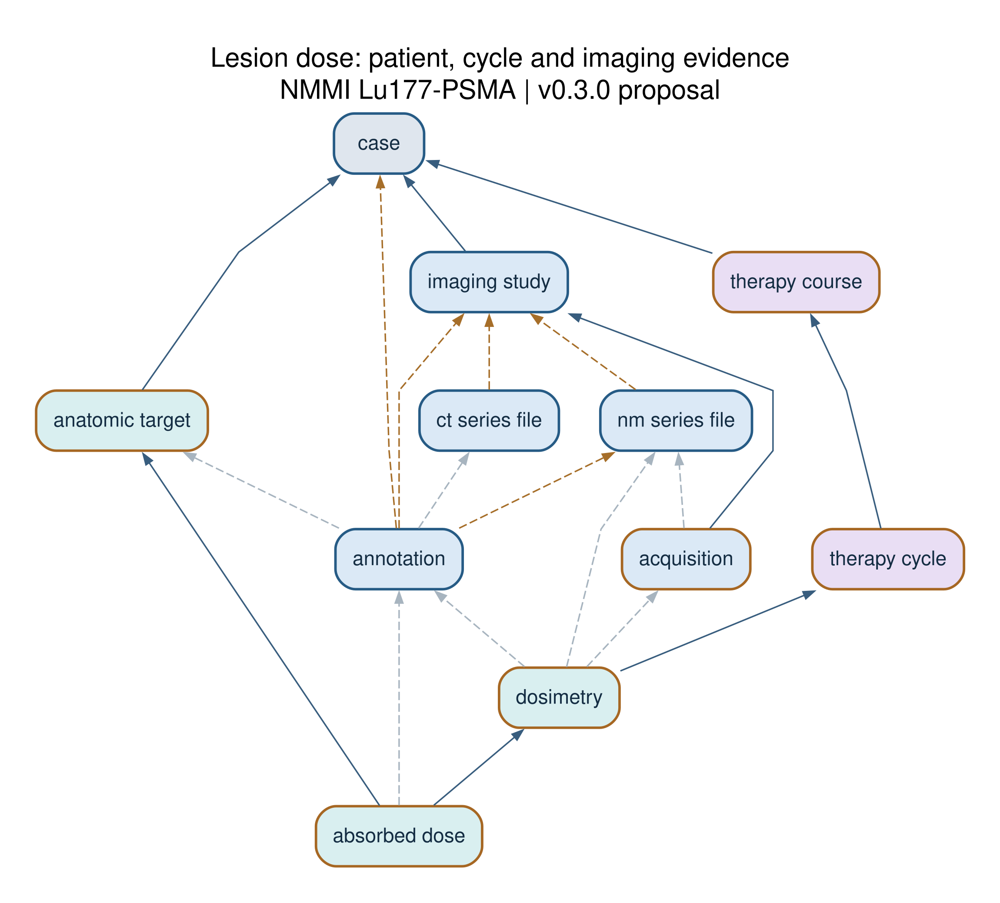

# Lu177-PSMA data model: architecture and use cases

Repository release **0.3.0**. This page transcribes the author-supplied v0.3.0 architecture document; the source Word file is [available here](../extensions/lu177_psma/v0.3.0/NMMI_Lu177_PSMA_Architecture_and_Status.docx). The working-artifact proposal status is retained.

**tentative authors list**

Nicolas A Karakatsanis, Atlas Haddadi Avval, Julia Brosch-Lenz, Irene Buvat, Abhinav Jha, Mario Jreige, Quanzheng Li, Neeta Pandit-Taskar, Babak Saboury, Jazmin Schwartz, Tahir I Yusufaly, Tyler J Bradshaw

Prepared for the Lu177-PSMA data model working group within the SNMMI AI Task Force and Computational Nuclear Ontology Working Groups, with a technical handoff for MIDRC Gen3 developers.

This revision makes the proposed model an additive extension of the deployed MIDRC dictionary. It reuses MIDRC record types and property definitions for images, measurements, observations and annotations, while preserving the theranostics course, cycle, dose, safety and outcome relationships. Graph views, table views and JSON schemas are generated from the same structure.

| Revision result | Scope |
| --- | --- |
| MIDRC foundation | 29 baseline nodes retained; 17 receive optional additions and 12 are unchanged. |
| Theranostics extension | 38 proposed nodes; 67 total node types and 293 relationships in the merged model. |
| Source continuity | 921 source-field occurrences, including all 94 revised outcome elements and 65 paper-table occurrences. |
| Examples and validation | Five use cases, a nine-stage patient journey and 122 invented linked records. Local structural tests pass. |

The model and its dictionary remain under development. This package is ready for technical review; a receiving Gen3 build, staging submission and terminology-owner approval are still required before adoption as a MIDRC release.

## The model dictionary and semantic layer

The project uses three complementary layers: record structure, field definitions and semantic meaning. Terminology and ontology have different roles within the semantic layer. In Gen3, one executable dictionary carries both the model links and the property definitions, so these layers are conceptually distinct even when implemented in one schema. [1]

| Component | Responsibility | Lu177 PSMA example |
| --- | --- | --- |
| Data model | Entities, record identity, relationships, cardinalities and temporal context. | A dose estimate references a lesion, a calculation run and its cycle; the run cites acquisitions and contours. |
| Data dictionary | Field names and definitions, types, allowable values, units and validation rules. | absorbed_dose_gy is numeric in Gy; its dose statistic and uncertainty context are explicit. |
| Terminology | Standard codes, preferred labels, synonyms and controlled value sets. | A LOINC code identifies a particular assay meaning; it does not contain the numeric result or identify the patient. |
| Ontology | Formal concepts and semantic relationships, potentially supporting logical inference. | An external ontology can define kinds of measurements, anatomy and processes, and approved relations between them. |

### Terminology and ontology can overlap

A terminology may have ontological structure. LOINC provides structured identifiers for observations and has ontology-related products. RadLex supplies a radiology ontology and vocabulary; its procedure naming resources also support standardized exam identification. NucLex is the developing nuclear-medicine ontology. They should not be treated as three interchangeable code lists. [4–6]

The data model does not redefine NucLex or RadLex classes. It supplies places to record their approved identifiers and versions. A foreign-key relationship from dose D1 to lesion L1 is an assertion about particular records. It does not automatically assert an ontology relation between all dose and lesion concepts.

### Independent versioning

Keep model, dictionary and terminology/ontology versions separate. A preferred-label correction can leave record structure intact. A changed quantity, unit, data type, link cardinality or record grain may require a migration. This permits definitions to be aligned with NucLex as it develops without silently reinterpreting previously collected data.

## Two examples across the layers

### PSA baseline and response confirmation

Store one measured PSA value in a measurement record, linked to its patient and laboratory_panel. Its dictionary specifies the numeric result, unit, assay identity, specimen context and timing. A response_assessment points to the relevant measurement through baseline_psa_results, nadir_psa_results or confirmatory_psa_results. These role-specific links distinguish the observations without copying their numeric values into the response row.

LOINC 2857-1 is an illustrative code for PSA mass concentration in serum or plasma when that meaning matches the assay. The synthetic total-PSA serum example uses this code with ng/mL. It must not be applied indiscriminately to free PSA, ratios or other PSA-related assays. A released implementation must pin and review its terminology version. [4]

| Layer | Contribution to the example |
| --- | --- |
| Model | Measurement M1 is the baseline for response R1; M2 is its later confirmation. Both belong to the same patient and course context. |
| Dictionary | test_result_number stores a number; unit, specimen_type and test_code describe its representation and assay identity. |
| Terminology | The assay code can be the same on M1 and M2 because their measurement meaning is the same. |
| Ontology | A reviewed external binding supplies the formal concept relationships; no NucLex ID is invented in this package. |

### A target dose and its provenance

The dictionary defines absorbed_dose_gy and the required statistic. Terminology supplies approved names or codes for the quantity, anatomical target and method. The model links the value to one persistent target and one calculation run; that run links to a cycle and its acquisition and contour evidence. An ontology may describe the concepts involved, but it does not replace those patient-specific links.

Activity in MBq and absorbed dose in Gy remain separate quantities. A dose-map file, a mean dose and a cumulative dose summary are also different records: an artifact, a target-specific estimate and an explicitly derived aggregate. A common label such as “dose” is insufficient to establish equivalence.

### Practical curation workflow

Retain source labels, approve a dictionary definition and representation, then bind it to a verified terminology or ontology concept. Store mapping relation, version, source and review status. Exact, broader, narrower and related mappings are different assertions. A reviewed mapping does not by itself validate a clinical decision.

## Reuse of the MIDRC foundation

The baseline is the deployed MIDRC dictionary retrieved on 16 October 2026: version 1.4.3-2-g7505333, commit 7505333d56c87a289463a814131e38d0f2be6674. The complete snapshot, SHA-256, original uploaded templates and change audit are included. Existing node metadata, required lists, types, definitions, relationship multiplicities and subgroup rules are preserved. [2, 3]

| Earlier proposal | Canonical version 0 3 structure |
| --- | --- |
| imaging_series and image_file | pt_series_file, nm_series_file, ct_series_file or mr_series_file, selected by modality. |
| laboratory_result and roi_measurement | measurement profiles, using the existing numeric result property with units and evidence links. |
| anthropometric_assessment | One measurement per body-size/composition metric; method and timing remain explicit. |
| lifestyle_assessment | One dated observation using observation_name and observation_answer. |
| segmentation | annotation with target identity, method, parameters and software provenance. |
| segmentation_file | dicom_annotation_file for DICOM SEG/RTSTRUCT, or annotation_file for supported non-DICOM artifacts. |
| dose_map_file | dicom_annotation_file with proposed RTDOSE support, or supplementary_file for other formats. |
| raw_imaging_file and clinical_document_file | supplementary_file; a structured radiology report may use radiology_report when its content fits. |

Eleven earlier node types are retired. Legacy outcome aliases already superseded by the revised specification are also removed from the current schemas and mapped to canonical destinations. Original source entries remain searchable; a migration changes where a fact is represented, not the provenance of its source definition.

All 824 baseline property definitions are unchanged except seven declared enum appends. The legacy measurement test-name and procedure-name enums remain intact. Added coded and source-label fields accommodate other assays and procedures without replacing those enums with unrestricted strings. Source labels are preserved evidence, not competing canonical concepts.

This audit resolves known structural duplication and explicit aliases. Complete semantic deduplication still needs clinical and ontology review, especially for remaining candidate assessment fields with overlapping wording. Reusing a spelling is not proof that quantity, specimen, timing and scope match.

## PET planar and SPECT file representation

### Use the existing modality specific nodes

PET image packages use pt_series_file and modality PT. Planar and SPECT images use nm_series_file and modality NM. The proposed nm_acquisition_kind property distinguishes planar, SPECT, other and unknown. Hybrid PET/CT or SPECT/CT examinations retain separate CT file records linked to the imaging study. MIDRC’s PT ct_images Boolean is preserved, but it does not replace CT file metadata.

| Field or relationship | Integration behavior |
| --- | --- |
| File metadata | Reuse file_name, file_size, md5sum, object_id, data_format, data_type and data_category with their existing constraints. |
| Identity | Keep series_uid and file-object identity distinct. Multiple file packages can share a series UID. |
| Geometry | Existing PT slice_thickness and CT/MR pixel_spacing remain arrays of numbers. Scalars from older exports need explicit conversion. |
| Source header | The file radiopharmaceutical string remains DICOM source metadata. The administration record is the authoritative injection event. |
| Parent alternatives | Existing series-file nodes require at least one of core_metadata_collections or imaging_studies. Both are allowed. |
| Theranostics profile | Patient-linked imaging additionally requires imaging_studies. This profile does not strengthen the global MIDRC baseline for unrelated submissions. |

### Acquisition and processing provenance

An acquisition record captures scanner, QA, timing and acquisition parameters. A reconstruction identifies a processing execution and its input acquisitions/raw files and output typed image files. Registrations identify moving and reference images. These processing records point to file artifacts; the files do not gain reverse dependency links that create type cycles.

### Contours and dose maps

An annotation identifies a contour execution. Its anatomic_target tracks the same lesion or organ across time, while the contour itself is image-specific. DICOM annotation artifacts retain the baseline data_type and data_category values. The proposed RTDOSE modality and two provisional NMMI annotation workflow names require MIDRC approval before use in the deployed dictionary.

Uncertain DICOM source labels stay explicit until their modality, attribute, sequence path, units and multiplicity are adjudicated. For example, a confirmed CT Acquisition Type uses the existing CT property; an ambiguous acquisition-type source label is not coerced into the CT enumeration.

## A lesion dose in the connected model

The focused graph shows how an estimate connects to its patient, cycle and imaging evidence. Blue borders identify existing MIDRC node types; brown borders identify proposed theranostics nodes.



*Figure 1. Arrows point to referenced records. Solid lines are required relationships; pale dashed lines are optional. Brown dashed lines are members of required alternative groups. The full group and multiplicity are shown in the HTML table view. Other links are omitted here for readability.*

## Use case following a lesion dose

SYN-DOSE-LESION-C1 is one mean absorbed-dose estimate for the persistent lesion SYN-TARGET-LESION-1. The lesion belongs to SYN-CASE. The estimate points to a dosimetry run, which belongs to cycle 1 and references two post-therapy acquisitions. Its two segmentation records identify the contours and software used on the corresponding images. A new estimate or revised contour receives a new record; the lesion identity is retained.

| Model relationship | What it establishes |
| --- | --- |
| absorbed_dose.anatomic_targets → anatomic_target | The dose estimate belongs to one tracked lesion or organ. |
| anatomic_target.cases → case | That target belongs to exactly one patient. |
| absorbed_dose.dosimetries → dosimetry.therapy_cycles → therapy_cycle | The estimate is attached to one calculation run and its treatment cycle. |
| dosimetry.acquisitions → acquisition | The run cites the 24-hour and 48-hour post-therapy acquisition records. |
| acquisition.nm_series_files; annotation.anatomic_reference_ct_series_files → nm_series_file / ct_series_file | SPECT uses NM; the contour cites its anatomical CT reference. Both files refer to the same examination. |
| dosimetry.annotations; absorbed_dose.annotations → annotation | The dose record cites the target-specific contours and their software/method. |
| dosimetry.method; annotation.segmentation_method → Method properties | The calculation and segmentation methods are preserved with parameters and software versions. |

The first-cycle example links the lesion estimate to the 24-hour and 48-hour post-therapy acquisitions. Their SPECT artifacts are NM files. The contours reference the anatomical CT files from the corresponding examinations. Separate contour identifiers preserve each image-specific delineation while sharing one tracked lesion identifier.

One target can have many contours over time, and one cycle can have multiple calculation runs. Each absorbed_dose record identifies one target, one run and one statistic. A dose_summary lists its component estimates and aggregation method; it must not sum alternate estimates of the same exposure as if they were different cycles.

The compact second-cycle summary explicitly marks its acquisition/contour evidence as partial. It remains a demonstration of missing provenance rather than a reproducible dose calculation. First-cycle evidence is never substituted for the missing second-cycle records.

## Domains for identity imaging and quantification

Domains organize navigation; nodes define record types. One domain can span several nodes, and one node can serve multiple domains. The four laboratory families share one measurement structure. The 24 navigation domains preserve the original multimodality scope.

| Domain | Nodes and purpose |
| --- | --- |
| Subject information | case, site; Stable project-scoped case identity and site context. |
| Anthropometrics and body composition | measurement; Atomic height, weight, body composition and derived body-size measurements. |
| Lifestyle and behavioral factors | observation; Dated observations with original behavior labels; baseline case summaries remain distinct. |
| Study and longitudinal context | study, dataset, visit, therapy_course, therapy_cycle, timepoint, treatment_transition; Protocol, collection, encounter, course, cycle, timepoint and later treatment. |
| Imaging examination | imaging_study, pt_series_file, nm_series_file, ct_series_file, mr_series_file; Examination plus typed file metadata for PET, NM, CT and MR. |
| Raw imaging data | supplementary_file; Indexed raw projection/list-mode artifacts with format and version metadata. |
| Acquisition parameters | acquisition; Scanner-specific acquisition settings, timing, energy windows and context. |
| Scanner QA and calibration | scanner, scanner_qa; Equipment identity and dated calibration/QA with isotope context. |
| Reconstructed imaging data | pt_series_file, nm_series_file, ct_series_file, mr_series_file; Typed image files, geometry, quantitative units and source-header metadata. |
| Reconstruction and processing | reconstruction, registration; Processing executions, input/output evidence and registration transforms. |
| Segmentation and ROI metrics | anatomic_target, annotation, dicom_annotation_file, annotation_file, measurement; Persistent targets, image-specific annotations, mask files and atomic ROI metrics. |
| Dosimetry | time_activity_curve, dosimetry, absorbed_dose, dicom_annotation_file, supplementary_file, dose_summary; Activity curves, calculation runs, target estimates, dose maps and cumulative summaries. |

## Domains for clinical evidence and governance

| Domain | Nodes and purpose |
| --- | --- |
| Hematology labs | laboratory_panel, measurement; Blood counts with specimen/collection context and per-result units. |
| Renal function labs | laboratory_panel, measurement; Creatinine, eGFR and clearance with formula and normalization context. |
| Liver function labs | laboratory_panel, measurement; Liver chemistry/function measurements and reference ranges. |
| PSA and related assays | laboratory_panel, measurement; PSA assays and repeated samples; derived responses link to their evidence. |
| Clinical and molecular biomarkers | specimen, biomarker_assessment, clinical_assessment; Specimen-linked molecular/clinical assessments and their interpretation. |
| Treatment response and outcomes | response_assessment, survival_outcome, patient_reported_outcome, disease_burden, clinical_event, treatment_decision, treatment_transition; Criteria-specific response, disease burden, events, patient reports and survival. |
| Treatment administration | therapy_course, therapy_cycle, administration, treatment_plan, eligibility_assessment, treatment_decision; Plans, course/cycle context and actual radiopharmaceutical administrations. |
| Organs at risk functional status | organ_function; Organ-specific functional interpretation with supporting observations. |
| Toxicity CTCAE based | toxicity_event, toxicity_summary; Individual CTCAE event assessments and separate time-window summaries. |
| Medical records and history | condition, medical_history, medication, procedure, supplementary_file, radiology_report; Conditions, procedures, medications, history and supporting reports. |
| Radiopharmaceutical | radiopharmaceutical, radiopharmaceutical_batch, administration; Product identity, production batch and actual measured administration. |
| Semantics and governance | program, project, model_release, semantic_mapping, provenance; Project organization, releases, provenance and external semantic mappings. |

New course, cycle, administration and dose nodes have distinct record grains that are absent from the baseline. Remaining clinical and biomarker assessment nodes are retained as panels or interpretations; their implementation should reference atomic measurements rather than introduce independently maintained duplicate facts. This is a specific review item for the receiving team.

## Patient journey from diagnosis to dosimetry

The example is entirely invented. It follows a compact two-cycle initial course and a separate later retreatment course to make the links inspectable; it does not prescribe a regimen. Each narrative stage points to actual records in the accompanying JSON and HTML.

### 1 Diagnosis and first consultation

Patient SYN-CASE has a documented prostate cancer diagnosis and disease history. The initial visit records symptoms, ECOG status, prior therapy and the clinician’s prognostic assessment. A recorded risk score would retain its method and version; the model does not calculate prognosis.

Record types: case, visit, condition, clinical_assessment, medical_history, medication

### 2 Baseline evidence and eligibility

A diagnostic PSMA tracer injection and baseline PET/CT are distinct from therapeutic administrations. Baseline PSA, blood counts, renal status, pain and function are time-stamped. An eligibility assessment links this evidence to the applicable criteria and the documented clinician decision.

Record types: administration, imaging_study, measurement, patient_reported_outcome, eligibility_assessment

### 3 Agree the treatment plan

A versioned treatment plan records clinical intent, approval and rationale. The course and planned cycles provide longitudinal structure. The compact synthetic dataset illustrates two planned cycles; neither that count nor the invented activity values defines a recommended regimen.

Record types: therapy_course, therapy_cycle, treatment_plan

### 4 Deliver a cycle and acquire post-therapy images

The actual administration belongs to cycle 1 and specifies product, activity and reference time. Post-therapy SPECT/CT examinations at two illustrative times reference that same administration. Series, acquisitions, calibration and reconstruction records preserve how quantitative images were produced.

Record types: therapy_cycle, administration, timepoint, imaging_study, acquisition, scanner_qa, reconstruction, nm_series_file, ct_series_file

### 5 Track lesions and calculate dose

The same lesion identifier is used across time. Each contour is a distinct segmentation on a particular image. Activity measurements feed a time-activity curve and a dosimetry calculation. The resulting dose estimate references the lesion, calculation and segmentations; the calculation references the cycle and acquisitions.

Record types: anatomic_target, annotation, measurement, time_activity_curve, dosimetry, absorbed_dose

## Patient journey through review and follow up

### 6 Review safety and interim response

Laboratory and clinician CTCAE records, patient symptoms and imaging remain separate evidence streams. An early PSA rise is recorded without assuming flare or declaring automatic treatment failure. A treatment decision records the clinician’s interpretation and rationale for the next cycle. The same structure supports a hold, reduction or stop when documented.

Record types: measurement, toxicity_event, patient_reported_outcome, response_assessment, treatment_decision

### 7 Repeat cycles and complete the planned course

The next cycle receives new administration and assessment records while retaining the patient, course and tracked targets. Cumulative dose references its component estimates. Completion is recorded against the plan. Planned completion does not imply NLCB, and first progression would not itself create an NLCB record.

Record types: therapy_cycle, administration, dose_summary, therapy_course, treatment_decision

### 8 Assess multidimensional outcomes

Serial PSA and its confirmation support a biochemical assessment. Baseline and follow-up whole-body tumor burden support a separate RECIP assessment. Pain response links baseline, follow-up and confirmatory patient reports with opioid context. Clinician CTCAE summaries and PRO-CTCAE item responses remain distinct.

Record types: disease_burden, response_assessment, patient_reported_outcome, toxicity_summary

### 9 Continue follow-up and link later treatment

Subsequent symptomatic skeletal events, survival follow-up and later therapy are retained. Time to next treatment uses the declared last-administration origin. Retreatment creates a new course, linked through a transition, rather than overwriting the original course or restarting its cycle numbers.

Record types: clinical_event, survival_outcome, treatment_transition, therapy_course

### Preserve the information available at each decision

First evidence, confirmation, interpretation and clinical decision have different dates. A new plan, contour or calculation run can supersede an earlier version while retaining its inputs and provenance. Later interpretations must not silently become information that appears to have been available at the initial visit.

### Make the temporal anchor explicit

The MIDRC case index event and a therapy-course start are separate anchors. A source label “first therapeutic administration” is not silently relabeled as MIDRC “Study Enrollment.” The synthetic example omits the incompatible case enum and retains its course and administration anchors. An implementation must choose its approved case index event and apply a consistent date-shifting policy across linked records.

## Revised outcome framework

The supplied manuscript and spreadsheet propose five complementary outcome dimensions. The current catalog retains all 94 revised elements and 65 paper-table occurrences, including their role, priority, unit of analysis, assessment timing, status and revision notes. Core, Recommended and Exploratory are source priorities; they do not establish a validated core outcome set. [7, 8]

| Dimension | Records and interpretation |
| --- | --- |
| Biochemical response and kinetics | laboratory_panel, measurement, biomarker_assessment, response_assessment; Keep baseline, nadir, serial and confirmatory evidence distinct; early rise is not a prospective flare label. |
| Molecular and anatomic imaging | imaging_study, anatomic_target, annotation, measurement, disease_burden, response_assessment; Separate lesion observations, whole-body burden, RECIST response, PCWG progression and RECIP response. |
| Dosimetry and dose–outcome relationships | administration, acquisition, annotation, dosimetry, absorbed_dose, dose_summary, response_assessment, toxicity_event, study; Dose is an exposure. Link target-specific estimates to response and toxicity without treating association as causation. |
| Clinical benefit, safety, function and patient-reported outcomes | clinical_assessment, clinical_event, patient_reported_outcome, toxicity_event, toxicity_summary, response_assessment, survival_outcome, therapy_course; Capture actual events and repeated instruments; separate clinician grading, patient reporting and course completion. |
| Longitudinal treatment trajectory | therapy_course, therapy_cycle, treatment_plan, treatment_decision, treatment_transition, medication, procedure, survival_outcome; First progression, NLCB, last administration, planned completion, next treatment and retreatment are distinct events. |

### Distinguish the role of a variable

Administered activity and absorbed dose are treatment exposures. Baseline PSA and disease burden can be predictors or covariates. Response categories and event times are outcomes. NLCB and continuation beyond progression are clinical decisions. Method, uncertainty, date and instrument version are supporting metadata. Their analytic roles do not require separate duplicate copies of the underlying observation.

### Retain clinical evidence rather than a patient level outcome row

Whole-body disease_burden records support molecular response. Individual lesion metrics remain annotation-linked measurements. Response records cite baseline and follow-up evidence; survival records retain the event definition, origin, event indicator and censoring date. Treatment transitions connect separate courses or later medication exposures.

## Outcome definitions and remaining clinical decisions

| Topic | Representation in version 0 3 |
| --- | --- |
| PSA | Repeated measurement records with explicit baseline/nadir/confirmation links; early rise does not by itself establish flare or progression. |
| Molecular response | Whole-body PSMA-positive volume is separate from lesion-level metrics. RECIP assessment and PCWG progression retain distinct criteria/version fields. |
| Dose and uncertainty | Target, statistic, unit, method and uncertainty convention remain explicit. No universal PSMA-RPT organ tolerance is encoded. |
| Symptoms and safety | Clinician CTCAE, PRO-CTCAE items, pain, function and quality-of-life instruments retain separate evidence and versions. |
| Completion and NLCB | Planned completion is distinct from a documented no-longer-clinically-benefiting decision and its reason/date. |
| Later treatment | Actual retreatment uses a separate course; survival endpoints retain their own origin, event and censoring rules. |

The source materials contain conflicting RECIP OR-versus-AND wording. The limited consistency check retains the combined volume and new-lesion condition for RECIP progression; the original source wording remains in the crosswalk. This does not implement the full criteria framework. PCWG release-specific operational rules and CTCAE term-specific grade ranges remain review tasks. [9, 10]

Signed “best response” wording, baseline conventions, normalization, not-assessed and not-evaluable states also require adjudication. A numeric zero is not a universal missing value, and false is not a substitute for an unperformed assessment. The source catalog preserves these distinctions and conflicting definitions.

### How the physician uses these records

The model brings the relevant diagnosis, eligibility, imaging, laboratory, dosimetry, organ function, toxicity and response evidence together. The treatment_plan and treatment_decision records document the clinician’s chosen scheme and rationale. The model itself does not calculate the optimum administered activity, number of cycles or treatment interval.

## Additional use cases

### Keep biochemical and imaging assessments independently interpretable

The early PSA record is linked to its actual collection date and baseline. It is not retroactively relabeled using future data. Later biochemical and RECIP assessments keep separate criteria, dates and evidence. A treatment decision can consider both without collapsing them into a single unsupported composite endpoint.

Example paths: response_assessment.baseline_psa_results; response_assessment.confirmatory_psa_results; response_assessment.baseline_burdens / followup_burdens

### Relate organ exposure to toxicity and patient experience

A cumulative kidney dose references same-target component doses. Toxicity assessments can link dose and laboratory evidence. Patient-reported pain or PRO-CTCAE items remain instrument-specific records, while a pain-response assessment links baseline, follow-up and confirmation with opioid exposure. These links support an analysis; they do not establish that dose caused an event.

Example paths: dose_summary.component_doses; toxicity_event.absorbed_doses / laboratory_measurements; response_assessment.baseline_pros / followup_pros / confirmation_pros

### Distinguish completion, NLCB and retreatment

The example completes its planned course without an NLCB determination. In an alternative discontinuation scenario, a separate NLCB decision would retain its date, reasons and supporting evidence. Subsequent therapy and retreatment are linked through a transition to a new course; survival and next-treatment endpoints retain explicit origins and censoring.

Example paths: therapy_course.treatment_completed_as_planned; treatment_decision.therapy_courses; treatment_transition.prior_courses / subsequent_courses

### PET, planar and SPECT without duplicate image nodes

The baseline PET file is a pt_series_file linked to its imaging_study. Its CT companion is a ct_series_file. The post-therapy SPECT and planar files are nm_series_file records with different nm_acquisition_kind values. The file-level DICOM radiopharmaceutical header is source metadata; the administration record remains the authoritative injection event.

Example paths: pt_series_file.imaging_studies; nm_series_file.imaging_studies; imaging_study.administrations

Each use case in the explorer opens the actual synthetic records and their node definitions. This makes the model reviewable as a set of connected records, including which observation supports which interpretation or decision.

## JSON templates tables and relationship rules

The combined dictionary and 67 individual schemas use Gen3 node conventions: id, category, links, properties, required fields, system properties and unique keys. The graph edges and table rows are derived from these schemas. Proposal record-grain metadata and source crosswalks live in external registries so that baseline definitions are not rewritten with local annotations.

### One quantitative laboratory record

This abbreviated invented record shows the canonical structure. It is a completed payload shape; its linked records must already exist. The code is illustrative for the matching total-PSA serum assay, not an automatic mapping for all PSA tests.

```json
{
"type": "measurement", "submitter_id": "EXAMPLE-PSA-01",
"cases": [{"submitter_id": "EXAMPLE-CASE"}],
"laboratory_panels": [{"submitter_id": "EXAMPLE-PANEL"}],
"measurement_profile": "laboratory",
"test_name_source_value": "Total PSA",
"test_code": "2857-1", "test_code_system": "LOINC",
"specimen_type": "Serum",
"test_result_number": 42.0, "unit": "ng/mL"
}
```

### Portal templates are not submission payloads

The supplied portal convention marks required keys with an asterisk, such as *submitter_id. Expanded templates retain that convention and contain blank nulls. Remove the marker, fill required values, drop unfilled optionals and preserve real parent references before validation. The cleanup helper does not fill missing data or make an incomplete record valid.

A required subgroup still needs at least one link even when its members are individually optional. For example, a PT file needs core_metadata_collections or imaging_studies in the baseline; the theranostics profile additionally expects imaging_studies. A general JSON validator does not enforce all Gen3 link-group semantics, so the package checks these explicitly.

The uploaded PT/NM templates contain urls, but the pinned live schemas do not. The expanded node templates omit it and provide a separate file-index manifest. Confirm the receiving upload/Indexd workflow before assigning object_id values.

## Developer handoff and integration sequence

The integration folder supplies the exact additive patch, node/property delta, seven proposed enum additions, audit of all five uploaded templates, expanded copies of those templates, self-contained YAML schemas and an integration guide. Applying the patch to the pinned baseline reproduces the compiled merged JSON exactly.

| Review step | Required result |
| --- | --- |
| Confirm baseline | Match the receiving dictionary commit; rebase and review changes if it differs. |
| Approve additions | Agree node grains, annotation workflow names, RTDOSE support and collection profiles. |
| Build in Gen3 | Integrate shared definitions/terms as appropriate, generate dictionary/data-model classes and run repository tests. |
| Stage data | Provision administrative resources, register test files and submit records in dependency order. |
| Verify retrieval | Check graph/table views, link/backref queries, file access, export, record revisions and existing MIDRC regression data. |
| Release review | Adjudicate clinical semantics and ontology mappings using representative de-identified cases before production adoption. |

The merged _settings retains the original MIDRC baseline provenance. The extension version is recorded separately in release_manifest.json. The receiving build must assign its own dictionary version and commit; the baseline commit must not be presented as the commit of a new deployed release.

### Proposed review responsibilities

The clinical working group should review scope, record grain and evidence requirements. MIDRC developers should review the schema changes, migration and service behavior. Terminology and ontology owners should approve semantic bindings. The resulting release decision should record these reviews and their versioned outputs.

### Implementation boundary

The source dictionaries and uploaded templates establish the interface baseline. Passing local JSON Schema and Gen3 metaschema checks provides useful evidence, but it does not prove compatibility with a particular deployed service version, database migration, portal configuration or authorization setup. Those are the concrete next integration checks.

## OMOP and external semantic governance

MIDRC integration and OMOP mapping are separate interoperability tasks. The current OMOP crosswalk retains domain-level candidate destinations against CDM 5.4; it is not executable ETL or a validated concept assignment. [11]

| Content | Candidate OMOP destination | Meaning to retain |
| --- | --- | --- |
| Patient and encounter | PERSON; VISIT_OCCURRENCE | Project identity and explicit encounter context. |
| Administration | DRUG_EXPOSURE; selected MEASUREMENT | One actual injection; radionuclide activity is not medication mass. |
| Course and cycle | EPISODE and EPISODE_EVENT where appropriate | Distinct longitudinal episodes and constituent events. |
| Labs ROI metrics and doses | MEASUREMENT | Metric, unit, target, statistic, method and evidence. |
| Diagnoses and interventions | CONDITION_OCCURRENCE; PROCEDURE_OCCURRENCE | Dated clinical events and source interpretation. |
| Toxicity response and survival | OBSERVATION; MEASUREMENT; EPISODE; DEATH as applicable | Criteria, grade, origin, confirmation and censoring. |
| Image and dose artifacts | Indexed external artifacts or named imaging extension | Full acquisition and processing provenance. |

Core OMOP uses DRUG_EXPOSURE and drug concepts in vocabulary tables, not a standalone core DRUG table. DEVICE_EXPOSURE describes use of a device in a person’s care; it does not replace an equipment/calibration registry. FACT_RELATIONSHIP is not a universal substitute for every imaging-processing link.

### Semantic mappings remain separately governed

A semantic_mapping record can bind a node, property or normalized source element to an approved identifier and release. Its mapping relation and review status are explicit. NucLex and RadLex identifiers are not invented here. The single LOINC assay example does not establish a completed LOINC mapping for the entire field inventory.

Clinical assessment panels, organ function interpretations and biomarker records need final agreement on their boundary with atomic measurements and observations. The review log identifies this overlap question so that a future integration does not maintain competing values for the same clinical fact.

## Validation development status and release decisions

Local validation passes for 67 JSON schemas and the deployed Gen3 metaschema. It confirms preservation of 29 baseline nodes and 824 existing property definitions apart from the seven explicit enum additions, exact patch reproduction, 67 template structures, 921 source destinations, and an acyclic dependency graph with MIDRC’s administrative roots preserved.

The 122-record invented patient journey covers 55 used node types. A separate set of 29 independent schema regression fixtures tests baseline acceptance. Twenty-seven intentionally invalid cases are rejected, including incorrect PT/NM routing, scalar slice thickness, an unsupported test-name enum, missing required link groups, dangling parents, cross-patient evidence, dose/contour target mismatch and selected outcome-evidence inconsistencies.

| Evidence or milestone | Current status |
| --- | --- |
| Source maturity | Main worksheet: 321 named entries, 13 marked finalized, 33 first-review entries, no populated second-review or approval entries in the supplied file. |
| Outcome revision | 94 revised spreadsheet elements and 65 paper-table occurrences retained; source conflicts remain visible. |
| Technical tests | Local checks pass; live Gen3 compilation, ingestion, indexing and portal rendering remain unverified. |
| Clinical and semantic review | 65 review items include historical findings and new integration decisions; not all are proven errors or unresolved technical failures. |
| Dissemination plans | The team has described a working GitHub release in November and a journal publication goal by end 2026; these are intentions, not completed milestones. |

The earlier abstract’s 256-element/21-category snapshot and the expanded workbook counts describe different stages and units of counting. Source occurrences, unique concepts, node properties and navigation domains must not be reported interchangeably. The current source catalog includes repeated entries and aliases; it does not claim 921 approved concepts.

The HTML has passed DOM-based navigation, filtering, graph-node count and download checks. Browser rendering was unavailable for this revision; graphical SVGs and document pages were inspected separately. The data model has not been tested with real patient records, verified file bytes or a complete clinical criteria engine.

## References and source materials

The unchanged uploaded templates and original wording from the supplied clinical sources are retained in the source audit. Current mappings are in mappings; historical v0.2 mappings are clearly prefixed under sources. Tentative authorship does not imply that every listed author has approved this implementation.

[1] Gen3 dictionary and model guide https://gen3.org/resources/user/dictionary/

[2] MIDRC dictionary portal https://data.midrc.org/DD

Deployed MIDRC JSON snapshot https://data.midrc.org/api/v0/submission/_dictionary/_all

[3] MIDRC dictionary repository https://github.com/uc-cdis/midrc_dictionary

[4] LOINC 2857-1 assay example https://loinc.org/2857-1

[5] RSNA RadLex https://www.rsna.org/practice-tools/data-tools-and-standards/radlex-radiology-lexicon

[6] NucLex ontology repository https://github.com/Nuc-Lex/NucLex

[7] PSMA_Theragnostics_outcomes_elements_NK(1).xlsx. Supplied revised outcome spreadsheet and framework guide; 94 field entries with roles, priorities, timing and revision notes.

[8] Beyond PSA50: Toward Integrated Outcome Assessment in 177Lu-PSMA Theranostics. Supplied working manuscript Lu177PSMA_Perspective_JNM_MJ_NK_v1.0(1).docx; 65 element occurrences in its two supplemental tables.

[9] Gafita et al RECIP 1.0 original framework https://pmc.ncbi.nlm.nih.gov/articles/PMC9635677/

[10] Armstrong et al PCWG4 recommendations https://doi.org/10.1200/JCO-25-02834

[11] OHDSI OMOP CDM 5.4 https://ohdsi.github.io/CommonDataModel/cdm54.html

Additional supplied project sources: NMMI Data Models Lu177-PSMA May2026.xlsx; the SNMMI abstract, domain architecture and OMOP mapping figures; Lu177_PSMA_Data_Model_BoxChart.pptx; and the five MIDRC portal JSON templates for dataset, imaging_study, nm_series_file, pt_series_file and visit.

MIDRC schema content is reused under Apache License 2.0. The license, source attribution and modification notice accompany the package. LOINC and the external ontologies retain their own governance and terms. Gen3/MIDRC interface and terminology references were checked for this revision on 16 October 2026; clinical source reviews carried forward from version 0.2 remain identified in the review log.

## Documentation patch 0.3.1

Repository release 0.3.1 clarifies baseline provenance and tag history. The architecture described here, its Word document and HTML explorer, and all model files retain their v0.3.0 content. See [patch notes](../releases/0.3.1.md).

## Repository baseline reconciliation

The repository source before this upload is commit `bee947238381704486ccd12beeb8f4689fb22843` on `cdis`. It includes a custom optional `pt_series_file.mr_images` boolean. That field is absent from the deployed baseline used by this proposal. The imported source is preserved, and any future application of the proposal to it must reconcile the PET/MR flag and other source-version differences explicitly. The proposed typed MR file relationships are documented separately; this release does not silently replace the custom flag.
